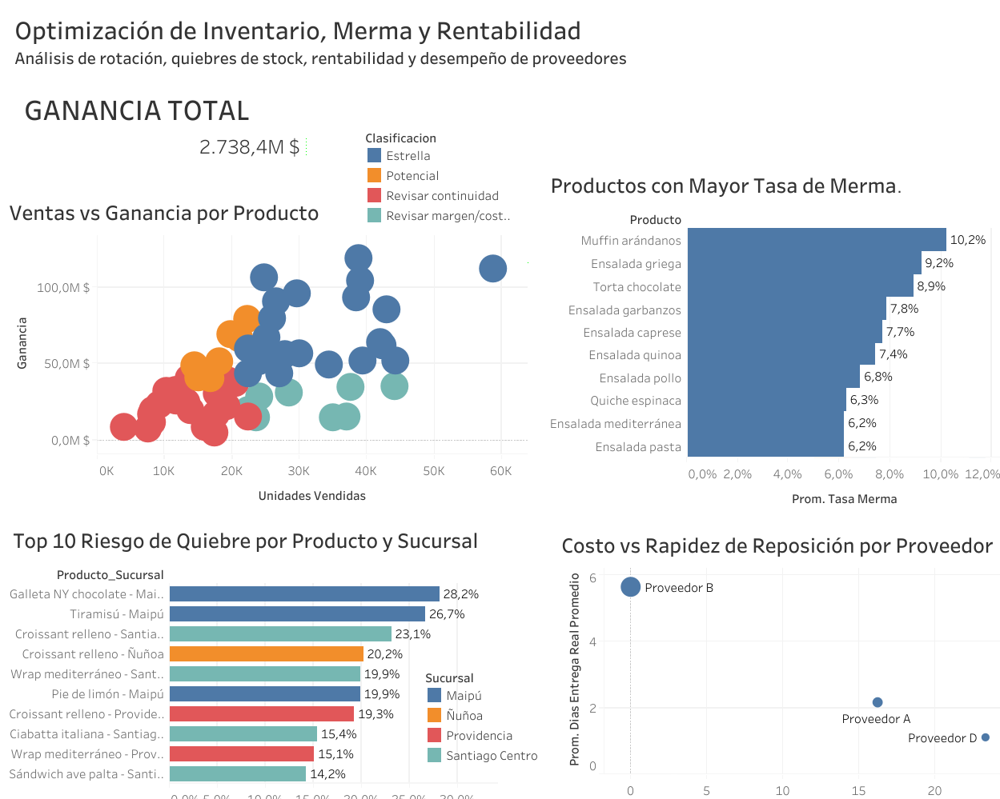

# Optimización de Inventario, Merma y Rentabilidad

Proyecto de análisis de datos enfocado en identificar oportunidades de mejora en **inventario, rotación, quiebres de stock, rentabilidad y desempeño de proveedores** para una cadena ficticia de cafeterías.

El análisis fue desarrollado con **Python** para la preparación, validación y exploración de datos, y **Tableau** para la visualización final.

> **Nota:** los datos utilizados son sintéticos y fueron generados con fines de portafolio.

---

## Dashboard interactivo

[](https://public.tableau.com/views/OptimizacindeInventarioMermayRentabilidad/OptimizacindeInventarioMermayRentabilidad?:language=es-ES&:sid=&:redirect=auth&:display_count=n&:origin=viz_share_link)

**Ver en Tableau Public:**  
https://public.tableau.com/views/OptimizacindeInventarioMermayRentabilidad/OptimizacindeInventarioMermayRentabilidad?:language=es-ES&:sid=&:redirect=auth&:display_count=n&:origin=viz_share_link

---

## Contexto del caso

La empresa analizada corresponde a una cadena ficticia de **4 sucursales**, con **60 productos perecibles** distribuidos en cinco categorías:

- Panadería
- Pastelería
- Sándwiches
- Ensaladas
- Platos preparados

El período analizado comprende un año completo de operación.

La base principal contiene **87.600 registros diarios de operación**, mientras que la tabla de reposiciones contiene **50.667 líneas de abastecimiento**.

---

## Objetivo

Evaluar si la planificación de inventario y reposición está alineada con la demanda real, identificar productos con baja rotación o exceso de merma, detectar posibles quiebres de stock y analizar qué productos y proveedores generan mejores resultados para el negocio.

---

## Preguntas de negocio

### Inventario

1. ¿Qué productos presentan señales de sobreabastecimiento, acumulación de stock y merma recurrente?
2. ¿Qué productos muestran baja rotación de inventario y podrían mantenerse en stock por encima de su demanda real?

### Quiebres de stock

3. ¿Qué productos y sucursales presentan con mayor frecuencia señales de quiebre de stock?
4. ¿En qué casos los posibles quiebres podrían estar asociados a una planificación insuficiente de reposición o a tiempos de entrega demasiado largos?

### Rentabilidad

5. ¿Qué productos generan mayor ganancia después de considerar el costo de las unidades vendidas y las pérdidas por merma?
6. ¿Qué productos combinan alto volumen de ventas y alta ganancia, y cuáles venden mucho pero presentan una rentabilidad menos atractiva?

### Proveedores

7. ¿Qué diferencias existen entre proveedores de un mismo producto en costo unitario y tiempo de entrega?
8. ¿Qué proveedores ofrecen la mejor relación entre costo, rapidez de reposición y cumplimiento de plazos?

---

## Metodología

### 1. Validación de calidad

Se revisaron:

- valores faltantes,
- registros duplicados,
- tipos de datos,
- cantidades negativas o imposibles,
- ventas y mermas superiores al inventario disponible,
- coherencia del balance de inventario.

No se detectaron inconsistencias relevantes en la ejecución final.

### 2. Indicadores de inventario

Se calcularon métricas como:

- **Tasa de merma**
- **Sell-through**
- **Stock remanente**
- **Frecuencia de días con ventas bajas**
- **Frecuencia de días con stock al cierre**

### 3. Posibles quiebres de stock

La demanda esperada se estimó utilizando el **promedio de ventas de los 28 días anteriores** para cada combinación producto-sucursal.

Se marcó una señal de posible quiebre cuando:

- existía historial completo de 28 días,
- el producto terminaba el día sin stock,
- y las ventas observadas quedaban por debajo de la demanda esperada.

La demanda potencialmente no atendida debe interpretarse como una **estimación**, no como ventas perdidas confirmadas.

### 4. Rentabilidad

La ganancia se calculó después de considerar:

- ingresos netos,
- costo de las unidades vendidas,
- costo asociado a merma.

También se calculó el margen porcentual y se clasificaron los productos según ventas y ganancia:

- **Estrella**
- **Potencial**
- **Revisar margen/costos**
- **Revisar continuidad**

Los puntos de corte se determinaron utilizando las medianas de ventas y ganancia.

### 5. Proveedores

La comparación de proveedores consideró:

- sobrecosto frente a la alternativa más económica del mismo producto,
- tiempo prometido de entrega,
- tiempo real promedio,
- porcentaje de pedidos atrasados.

---

## Principales hallazgos

- **Muffin arándanos** presenta la mayor tasa de merma del portafolio, cercana al **10,2%**.
- La baja rotación se concentra especialmente en varios productos de la categoría **Ensaladas**.
- **Galleta NY chocolate en Maipú** registra la mayor frecuencia de posibles quiebres de stock, con aproximadamente **28,2%** de los días analizables.
- **Tiramisú en Maipú** ocupa el segundo lugar, con cerca de **26,7%**.
- Algunos productos presentan problemas diferentes según la sucursal, lo que demuestra que los resultados agregados pueden ocultar comportamientos locales.
- **Bagel salmón** genera la mayor ganancia total del portafolio, cercana a **$119,2 millones**, y también presenta el mayor margen, aproximadamente **55,9%**.
- **Proveedor B** ofrece el menor costo relativo, pero presenta mayores tiempos de entrega y mayor frecuencia de atrasos.
- **Proveedor D** es el más rápido, aunque también el más costoso.
- **Proveedor A** representa una alternativa más equilibrada entre costo, rapidez y cumplimiento.
- **Proveedor C** no registra pedidos observados en el período, por lo que no existe evidencia suficiente para evaluar su desempeño real.

---

## Dashboard

El dashboard final incluye:

- KPI de ganancia total.
- Dispersión de **ventas vs. ganancia** por producto.
- Top 10 de productos con mayor tasa de merma.
- Top 10 de riesgo de quiebre por producto y sucursal.
- Comparación de proveedores según costo y rapidez de reposición.

---

## Herramientas utilizadas

- **Python**
  - pandas
  - NumPy
- **Google Colab**
- **Tableau Public**

---

## Archivos del repositorio

```text
.
├── Caso_Estudio_3_Optimizacion_Inventario.ipynb
├── resumen_productos_tableau.csv
├── quiebres_reposicion_tableau.csv
├── proveedores_tableau.csv
├── dashboard_inventario.png
└── README.md
```

---

## Limitaciones

- El dataset es sintético y fue creado con fines educativos y de portafolio.
- Los posibles quiebres de stock se estiman a partir del comportamiento histórico de ventas; no existe una medición directa de clientes o ventas perdidas.
- No se dispone de trazabilidad por lote para estimar la antigüedad exacta de cada unidad en inventario.
- La ausencia de pedidos reales para Proveedor C impide evaluar su desempeño operativo observado.
- Las asociaciones entre retrasos de proveedor y quiebres de stock no deben interpretarse automáticamente como causalidad.

---

## Conclusión

El análisis muestra que optimizar inventario no consiste únicamente en aumentar o reducir las compras. La planificación debe considerar simultáneamente **demanda, rotación, merma, sucursal, momento de reposición, rentabilidad y desempeño del proveedor**.

El proyecto demuestra cómo combinar análisis exploratorio, métricas operacionales y visualización para transformar datos de inventario en recomendaciones útiles para la toma de decisiones.
